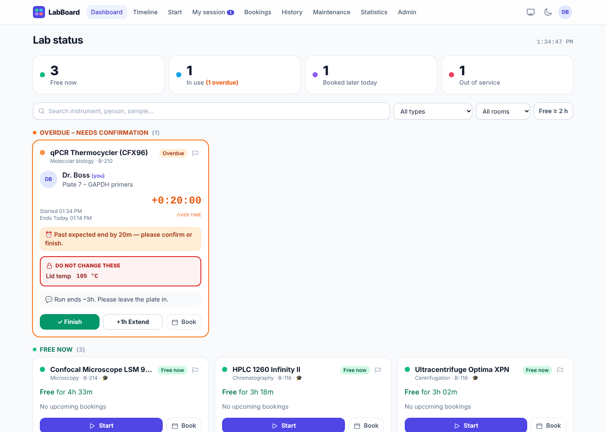
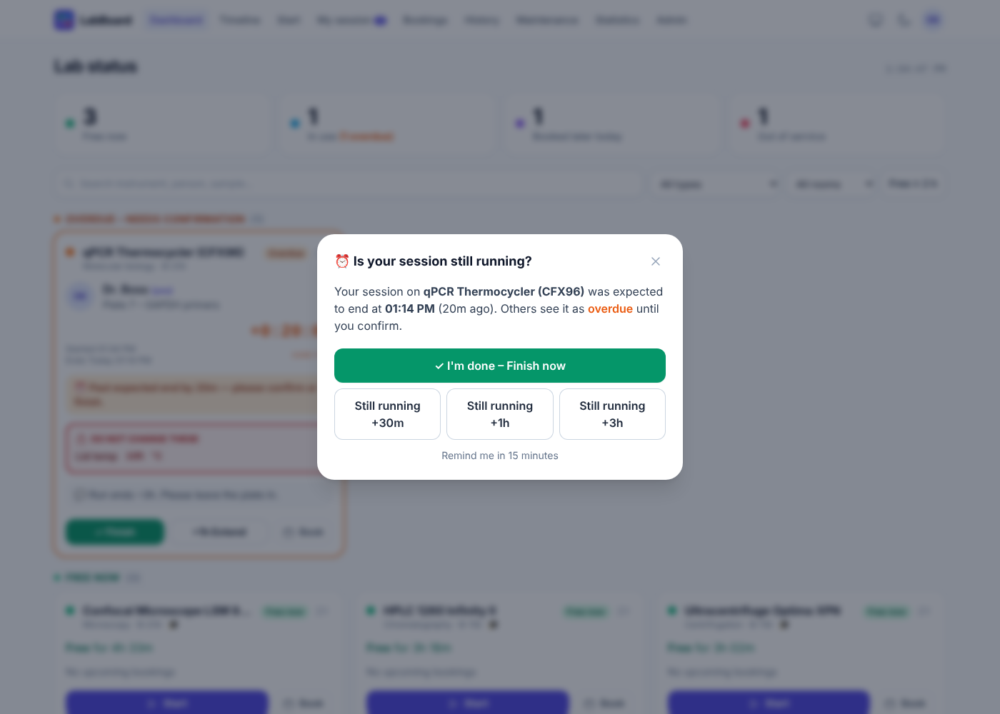
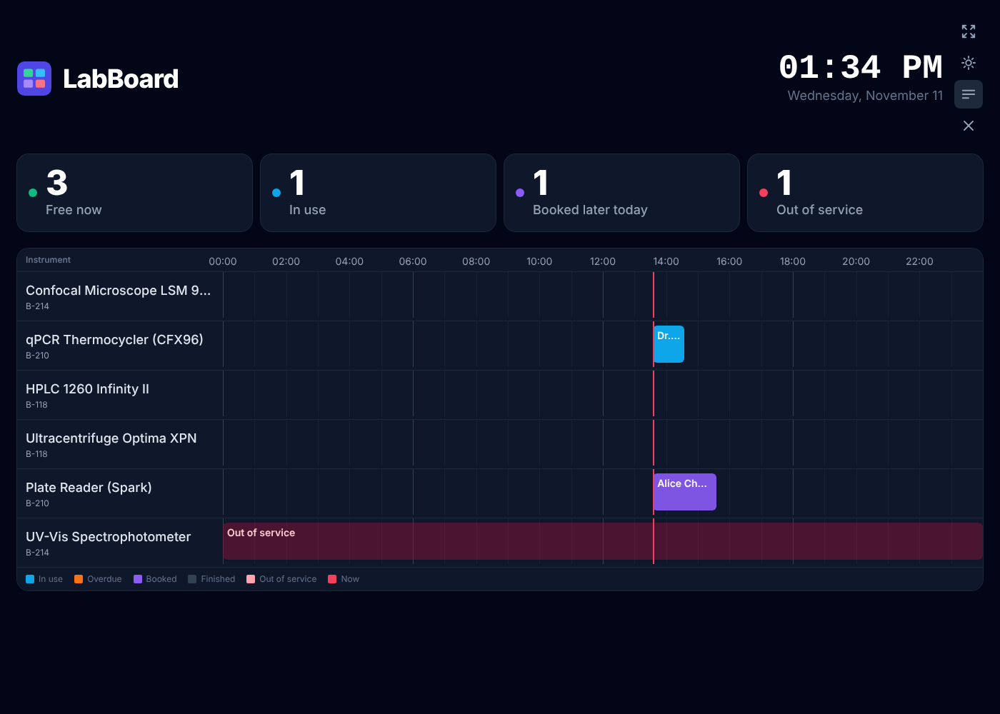
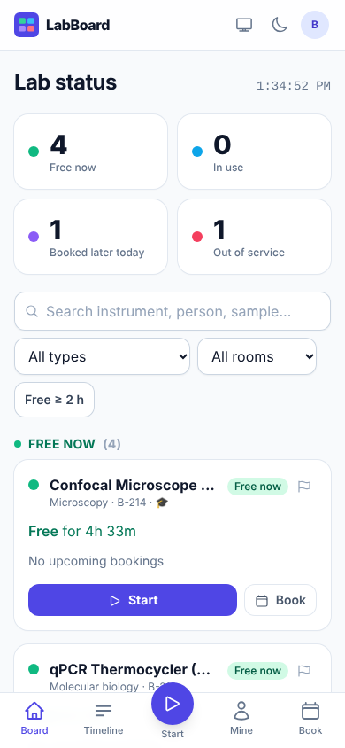

# LabBoard — AFMN Lab instrument board

Live board for the lab's shared instruments, at **https://afmn-lab.web.app/update**. Anyone in the lab sees in a second what is free, who is using what, and which settings they must not touch. Starting a session takes about 20 seconds.

> Not to be confused with the **Lab Dashboard** at `/admin.html`, which edits the *website* ([DASHBOARD.md](../DASHBOARD.md)). LabBoard is the instrument board. The two share one Firebase project (`afmn-lab`), sign-in and security-rules file, but use different Firestore collections and never touch each other's data.

**Stack:** React 18 + Vite + Tailwind CSS · Firebase Authentication (Google) · Cloud Firestore (real-time) · Firebase Hosting · installable PWA. Everything runs on the free **Spark** plan: no Cloud Functions, no Cloud Storage. See [Honest limitations](#honest-limitations-spark-plan).

| Dashboard (overdue session) | “Still running?” prompt |
|---|---|
|  |  |
| **Big-screen mode (dark)** | **Phone** |
|  |  |

---

## Contents

1. [Features by version](#features-by-version)
2. [How it is wired into the website repo](#how-it-is-wired-into-the-website-repo)
3. [Data model](#data-model-firestore-collections)
4. [Access control & security rules](#access-control--security-rules)
5. [Going live: one-time steps](#going-live-one-time-steps)
6. [Local development](#local-development)
7. [Everyday use](#everyday-use)
8. [Honest limitations (Spark plan)](#honest-limitations-spark-plan)
9. [Customising](#customising)

---

## Features by version

All three versions are in this codebase. They are listed separately so you can roll them out to the lab in stages.

### Version 1: core board
- **Google sign-in with approval.** A user gets in if their email is on the approved list or belongs to your university domain. Everyone else waits on a “Waiting for approval” screen, which updates live as soon as an admin approves them.
- **Roles:** `admin`, `member`, `guest` (guests are read-only, e.g. a lab-monitor account).
- **Live dashboard.**
  - A **summary strip** shows Free now / In use (with overdue count) / Booked later today / Out of service. Tap a tile to filter.
  - The **instrument grid is grouped by status.**
    - *Free:* how long it has been free, and the next booking.
    - *In use:* user name and photo, sample/experiment, start time, a **live countdown** to the expected end, a bold red **“Do not change these”** box with the locked parameters, and the user's comments.
    - *Booked:* who reserved it and when. If the booking has started but nobody has begun a session, the card shows when it will be auto-released.
    - *Out of service:* the reason.
- **Start Session form, about 20 seconds:**
  - pick the instrument (busy, reserved, out-of-service and untrained instruments are greyed out with the reason)
  - set the expected end with quick buttons **+30m, +1h, +2h, +3h, +6h, +12h, Overnight (next 09:00)** or an exact time
  - optional sample name, locked parameters as key/value rows, and comments
  - it remembers the parameters you used last time on that instrument
- **My Session page:** one-tap **Finish**, quick **Extend** (+30m/+1h/+3h/+6h/+12h/exact), and in-place editing of comments and parameters.
- **Overdue handling:** when a session passes its end time, its card turns **orange** for everyone. The owner gets a pop-up on any page: *“Is your session still running?”* → Finish now / Still running +30m / +1h / +3h. The pop-up keeps coming back (snoozable for 15 min), so the board never stays wrong for long.

### Version 2: planning
- **Booking calendar** (week view per instrument). Tap a free slot, pick a length, done.
  - **Overlapping bookings are blocked**, both by a server re-check and by a race-condition guard (see limitations).
  - **Maximum booking length** per instrument, enforced in the security rules.
  - **Auto-release:** a booking nobody starts within **30 minutes** is released automatically.
- **Day timeline:** one row per instrument, coloured blocks across 24 h (in use / overdue / booked / finished / out of service), a “now” line, and day navigation.
- **Filters** by instrument type, room, and **“Free ≥ 2 h”**, plus a **search box** (instrument, person, sample).
- **History log:** searchable by instrument, person, date range and free text (sample, comments, parameters), with CSV export.
- **Saved parameter templates** per instrument. Apply one with a single tap on the Start form; save new ones with a checkbox.

### Version 3: management
- **Admin panel:**
  - add and edit instruments (**uploaded photo**, location, manual link, safety notes, required training, max booking length, restricted flag)
  - mark an instrument out of service or back in service
  - approve or revoke users and change roles
  - **training approvals** per restricted instrument
  - pre-approved email list (paste many at once)
  - force-finish stale sessions
  - **Photos library:** every uploaded image with where it is used, storage total, and one-click cleanup of unused photos
  - load sample data
  - CSV exports
- **Instrument detail page:** photo, location, manual, safety notes, required training (and whether *you* are approved), live status, upcoming bookings, maintenance, open issues, recent sessions.
- **Issue reports:** a flag button on every card and detail page, with a severity level and **up to 4 photos** (camera on phones, drag-drop or paste on desktop). Admins resolve issues, and critical issues come with a one-click “mark out of service”.
- **Maintenance & calibration schedule:** interval, last-serviced and next-due dates, overdue and due-soon highlighting, a “Serviced today” log button, and CSV export.
- **Usage statistics:** hours per instrument, per person and per month, plus idle capacity. Summary and raw CSV export.
- **Notifications** (in-app plus browser notifications while LabBoard is open):
  - 10 minutes before your session ends
  - when it becomes overdue, then every 30 min
  - 10 minutes before your booking starts
  - when your booking starts and the 30-minute release clock is running
- **Big-screen mode** (`/board`) for a lab monitor: huge type, live clock, alternates between cards and timeline every 30 s, full-screen button, keeps the screen awake (Wake Lock), dark-mode toggle.
- **Dark mode**, **mobile-first layout** with a bottom tab bar, and **installable PWA** (offline app shell, Firestore offline cache, app shortcuts).

### Version 4: chemical inventory (`/chemicals`)
- **Inventory for everyone:** what is in stock, how much is left (with a stock bar against the container size), where it is stored, GHS hazard symbols, CAS, grade, supplier, catalog and lot numbers, expiry date and a link to the safety data sheet.
- **One-click status filters:** in stock, low stock (at or below the reorder level), out of stock, expiring within 30 days or expired. Search by name, formula, CAS, shelf, supplier or catalog number (press `/`), and filter by category, location or hazard. Sort by name, lowest stock, expiry, location or last change.
- **Record what you use:** tap **Use**, type the amount (mL, L or µL — converted automatically), see what will be left before you save, and optionally say what it was for (pre-filled from your running instrument session). The stock can never go below zero, even if two people use the last bottle at once.
- **Reorder requests:** members flag “we're running out” with a note; admins see a red badge on Chemicals and close the request by restocking. Low or out-of-stock items without a request are listed too.
- **Usage log:** every stock change (used, restocked, stocktake, added) with person, time, amount and amount left; filter by everyone or just me, by type or text; this month's most-used chemicals; CSV export.
- **Admin tools:** add or edit chemicals (with photo), **Restock** (adds stock, new lot number and expiry), **Stocktake** (set the exact amount on the shelf — disposal, spills, recounts), delete, **Import CSV** from a spreadsheet (with a downloadable template) and **Export CSV**.

---

## How it is wired into the website repo

```
afmn-lab-website/
├── firebase.json            /update rewrite (single-page app), caching headers, indexes
├── firestore.rules          ONE rules file for the whole project: website dashboard + LabBoard section
├── firestore.indexes.json   one composite index (LabBoard: sessions by instrument + time)
├── .github/workflows/       all three deploy workflows build LabBoard before deploying
├── public/update/           ← build output (git-ignored, created by `npm run build`)
└── labboard/                ← this app's source
    ├── vite.config.js       base '/update/', builds straight into ../public/update
    ├── tests/rules.test.mjs 32 security-rule tests for the merged ../firestore.rules
    ├── public/              manifest, service worker (scope /update), icons
    └── src/                 lib/ contexts/ hooks/ components/ pages/
```

- **URL:** the app is served at `/update` (deep links such as `/update/bookings` work through the Hosting rewrite). To use another path, change `base` in `labboard/vite.config.js`, the `/update` entries in `firebase.json`, and `start_url`/`scope`/`id` in `labboard/public/manifest.webmanifest`.
- **Firebase config:** nothing to configure. On Hosting the app reads the project's web config from `/__/firebase/init.json`, exactly like the website dashboard. (`VITE_FIREBASE_*` variables override it for local work.)
- **Deploys:** pushing to `main` runs the existing Hosting workflows, which now run `npm ci && npm run build` in `labboard/` first. The service worker is scoped to `/update`, so the rest of the website is never intercepted.
- **Source layout:** `src/lib/data.js` holds every Firestore write, `src/lib/status.js` the card/auto-release logic, `src/pages/` one file per screen.

---

## Data model (Firestore collections)

The seven requested collections, the chemical inventory (`chemicals`, `chemicalLogs`), plus two helpers: `allowlist` for pre-approved emails and `labImages` for uploaded photos.

| Collection | Doc ID | Key fields |
|---|---|---|
| `users` | Firebase Auth uid | `email`, `name`, `photoURL`, `role` (`admin`/`member`/`guest`), `approved`, `trainedOn: [instrumentId]`, `notify` |
| `instruments` | auto | `name`, `type`, `room`, `location`, `photoURL`, `manualURL`, `safetyNotes`, `requiredTraining`, `restricted`, `maxBookingHours`, `status` (`ok`/`out_of_service`), `outOfServiceReason`, `activeSession: {sessionId, uid} \| null`, `freeSince` |
| `sessions` | auto | `instrumentId`, `instrumentName`, `userId`, `userName`, `userPhoto`, `sample`, `params: [{key,value}]`, `comments`, `startedAt`, `expectedEnd`, `endedAt`, `status` (`active`/`finished`), `bookingId`, `extendedCount` |
| `bookings` | auto | `instrumentId`, `userId`, `userName`, `start`, `end`, `purpose`, `status` (`booked`/`started`/`cancelled`/`released`), `sessionId` |
| `templates` | auto | `instrumentId`, `name`, `params`, `createdBy` |
| `issues` | auto | `instrumentId`, `reportedBy`, `description`, `severity`, `photos: [lbimg:<id>]` (≤ 4), `status` (`open`/`resolved`), `resolvedBy`, `resolution` |
| `maintenance` | auto | `instrumentId`, `kind` (`maintenance`/`calibration`), `title`, `intervalDays`, `lastServiced`, `nextDue`, `log[]` |
| `allowlist` | lower-case email | `role` |
| `chemicals` | auto | `name`, `formula`, `cas`, `category`, `grade`, `hazards: [flammable/oxidizer/…]`, `quantity`, `unit` (g/mg/kg/mL/µL/L/units/bottles/packs), `minQuantity` (reorder level), `containerSize`, `location`, `storage`, `supplier`, `catalogNo`, `lotNo`, `expiry`, `sdsURL`, `photo`, `notes`, `reorder: {uid, name, note, at} \| null`, `lastLogId`, `updatedAt`, `updatedBy` |
| `chemicalLogs` | auto | `type` (`use`/`restock`/`adjust`/`create`), `chemicalId`, `chemicalName`, `unit`, `amount`, `before`, `after`, `note`, `lotNo`, `userId`, `userName`, `createdAt`. Append-only. Members may only write `use` entries, and only together with the matching stock decrease (checked by the rules). |
| `labImages` | auto | `image` (JPEG data URL, ≤ 280 000 chars), `name`, `kind` (`instrument`/`issue`/`chemical`/`other`), `createdBy`, `createdByName`, `createdAt`. Immutable; deletable by the uploader or an admin. |

`instruments.activeSession` is a small lock. A session is started in a **transaction** that creates the session and claims the instrument together, so two people can never start on the same instrument at once. The rules verify the lock points at a real session owned by the caller (`getAfter`).

---

## Access control & security rules

All access control lives in [`firestore.rules`](firestore.rules). The UI only hides buttons; the rules are what actually protect the data.

| Action | Who |
|---|---|
| Read anything | approved users (any role) |
| Create own profile | Google sign-in only. `role`/`approved` must match: the site **owner** (admin), an **allowlist** entry, or the optional domain; otherwise stored as **pending guest** |
| Change roles, approve, grant training | **admins only** (users cannot edit their own role, approval or `trainedOn`) |
| Add / edit / delete instruments, mark out of service | **admins only** |
| Start a session | members/admins, for themselves only, instrument in service, **training approval required for restricted instruments** |
| Edit / extend / finish a session | **only the session owner** (admins may force-finish) |
| Create a booking | members/admins, for themselves only, in the future, ≤ `maxBookingHours`, training approval for restricted instruments |
| Cancel / move a booking | owner (or admin) |
| Release a no-show booking | any approved user, **only** once 30 min have passed since its start (checked with `request.time`) |
| Templates | anyone can read; creator (or admin) edits/deletes |
| Report issue | any approved user (guests too); admins resolve |
| Maintenance | admins write; everyone reads |
| Allowlist | admins only |

**Tests:** `tests/rules.test.mjs` has 32 tests against the **merged** `../firestore.rules`: every row above, plus checks that the website dashboard's own rules are unaffected (public content stays readable, LabBoard roles confer no website-editing power). The website's own end-to-end test (`tests/dashboard.e2e.cjs`) also passes on the merged rules.

```bash
cd labboard && npm run test:rules      # needs the Firebase CLI and Java 11+
```

---

## Going live: one-time steps

The Firebase project (`afmn-lab`), Google sign-in, Firestore and Hosting already exist for the website, so this is short.

1. **Merge the pull request into `main`.** The Hosting workflow builds LabBoard and deploys it. Until step 2 is done, `/update` loads but shows permission errors; the website is not affected either way.
2. **Deploy the merged security rules and index** (one command, from the repo root, signed in to the Firebase account that owns `afmn-lab`):
   ```bash
   npx firebase-tools login
   npx firebase-tools deploy --only firestore:rules,firestore:indexes --project afmn-lab
   ```
   This replaces the project's rules file with the merged one (website rules unchanged + LabBoard section). Run it again whenever `firestore.rules` changes. The index takes a few minutes to build; only the “Recent sessions” list on an instrument page needs it.
3. **Sign in at https://afmn-lab.web.app/update** with `muhammadshamsularefin01@gmail.com`. The site owner becomes LabBoard **admin** automatically.
4. **Add the lab:** **Admin → Approved list**: paste the lab members' Google emails (comma or line separated), choose *Member*, **Add**. They get in the first time they sign in. Anyone not on the list lands on a “Waiting for approval” screen, and you can approve them under **Admin → Users & training**.
5. **Add instruments:** **Admin → Instruments → Add instrument**, or **Admin → Data → Load sample data** to see the board with six example instruments first (delete them afterwards).
6. **Training-restricted instruments:** tick *Restricted* on the instrument, then grant people under **Admin → Users & training → Training**.
7. **Lab monitor:** create a Google account for it, add it to the Approved list as **Guest** (view only), sign in on the monitor's browser, and leave `https://afmn-lab.web.app/update/board` open (full-screen button, rotates between cards and timeline).
8. **Phones:** open `/update` and use *Add to Home Screen* / *Install*.

**Automatic approval for a whole domain (optional).** By default only people on the Approved list get in. To also let everyone on a university domain in as members, edit `lbDomainRegex()` in `firestore.rules`, e.g. `return '.*@gstu[.]edu[.]bd$';` (a dot is written `[.]`), and redeploy the rules (step 2). Also set `VITE_ALLOWED_DOMAIN` in `labboard/.env.production` so the login page mentions it.

**Changing the owner:** edit `OWNER_EMAIL` in `labboard/src/lib/config.js`, and `isOwner()` in `firestore.rules` (the same address the website dashboard uses; see DASHBOARD.md).

---

## Local development

```bash
cd labboard && npm install
npm run emulators        # terminal 1: Auth + Firestore emulators (needs Firebase CLI + Java 11+)
npm run dev:emu          # terminal 2: http://localhost:5173/update/
npm run test:rules       # 32 security-rule tests
npm run build            # production build into ../public/update
```
The login page then shows an **“Emulator sign-in”** box where any email can be typed. Sign in as `muhammadshamsularefin01@gmail.com` to be admin. To preview the real thing locally through Hosting rewrites: `VITE_USE_EMULATORS=true npm run build`, then `npx firebase-tools emulators:start --only auth,firestore,hosting --project demo-afmn` from the repo root and open http://127.0.0.1:5000/update.

---

## Everyday use

| I want to… | Do this |
|---|---|
| See what's free | Open the app: green cards, or tap **Free now** in the summary strip. Use **Free ≥ 2 h** for long runs. |
| Start using an instrument | **Start** (or **Start** on a card) → pick end time (+1h, +3h, Overnight…) → optionally sample, locked parameters, comment → **Start session**. |
| Protect my settings | Add them as **locked parameters**. They appear in a red “Do not change these” box on the card. |
| Re-use settings | Your last parameters are pre-filled; or tap a **template** chip; or tick “Save as template”. |
| I'm done | **Finish** on the card or on **My session**. One tap. |
| I need longer | **+1h Extend** on the card, or +30m/+1h/+3h/… on **My session**. |
| Reserve for later | **Bookings** → pick instrument → tap a slot → choose length → **Book**. Start the session within 30 min of the start or it's released. |
| Something's broken | Flag icon on the card → describe → **Send report**. |
| Find a chemical | **Chemicals** → search or tap a status tile (Low, Out, Expiring). Tap a row for location, hazards, SDS and history. |
| Log chemical use | **Use** on the chemical → amount → **Record use**. |
| We're running out | Open the chemical → **Request reorder**. |
| Find who ran what | **History** → filter by instrument / person / dates / text → **Export CSV**. |

---

## Honest limitations (Spark plan)

Spark is generous for a single lab, but it has **no Cloud Functions** (no server code) and, for projects created since Oct 2024, **no Cloud Storage bucket**. Here is what that means in practice:

| Area | What LabBoard does on Spark | What would need Blaze (or another service) |
|---|---|---|
| **Email / SMS notifications** | ❌ Not possible on Spark. LabBoard shows **in-app toasts and browser notifications only while LabBoard is open** (a tab, or the installed PWA running in the background on desktop/Android). | Email needs a server: Cloud Functions + the *Trigger Email* extension, or SendGrid/Mailgun, **all of which require Blaze**. True background push (FCM sent when the app is closed) also needs a server to send it. |
| **Auto-release of no-show bookings** | Done **client-side**: any open LabBoard (the lab monitor counts) releases bookings 30 min after their start. The rules enforce that nobody can release a booking earlier. If **no** LabBoard is open anywhere, the booking simply *looks* expired (the UI already treats it as released) and is cleaned up the next time someone opens the app. | A scheduled Cloud Function (Blaze) could do it on the server. |
| **Booking overlap prevention** | Firestore rules can't query other documents, so overlap is checked on the client against fresh server data. Then a **race guard** re-reads after writing: if two people booked the same slot within milliseconds, the later one is deleted and told. Max length, future-only, training and ownership **are** enforced by the rules. | A Cloud Function or per-slot lock documents could make it fully server-enforced. |
| **Overdue sessions** | The card turns orange and the owner is prompted whenever they have LabBoard open. Nothing finishes a session automatically, by design: only the owner (or an admin, via **Admin → Active sessions → Force finish**) may end it. | Auto-finishing or emailing the owner would need a server. |
| **Photo uploads** | Same approach as the ACS GSTU site: the browser resizes and JPEG-compresses each photo (long edge ≤ 1600 px, stepping down size/quality until it fits ≈ 200 KB) and stores it as a data URL in its own `labImages` document. Instruments and issues only keep a short `lbimg:<id>` reference, so the live board stays cheap to load; images are fetched once and cached. The rules check type, size and ownership. Existing `https://` photo URLs still work. | Full-resolution originals or videos would need Cloud Storage (Blaze on new projects). |
| **Quotas** | The website and LabBoard **share one Firestore quota**. Spark gives **50 000 reads, 20 000 writes, 1 GiB storage per day** for Firestore and **10 GB/month** hosting transfer. A lab of ~30 people with ~20 instruments uses a small fraction of this. Listeners are scoped (only active sessions, recent bookings), history/stats use one-shot queries, and Firestore's offline cache cuts repeat reads. | If you outgrow it (hundreds of users, many always-on monitors), Blaze is pay-as-you-go and has the same free tier included. |
| **Time zones** | All times are shown in each browser's local time zone. For a single-site lab that's correct. | — |
| **Clock skew** | Countdown/overdue use the device clock. Release timing is validated by the server clock in the rules. | — |

Everything else in the feature list works fully on Spark.

---

## Customising

- **Quick end-time buttons:** `src/components/EndTimePicker.jsx` (`QUICK` array; “Overnight” = next 09:00 via `nextMorning()` in `src/lib/time.js`).
- **Auto-release grace period:** `AUTO_RELEASE_MIN` in `src/lib/status.js` **and** `duration.value(30, 'm')` in `../firestore.rules`. Change both.
- **Default max booking length:** `DEFAULT_MAX_BOOKING_HOURS` in `src/lib/status.js` and the `12` default in `lbValidBookingTimes()` in `../firestore.rules`. Per-instrument values are set in Admin.
- **Big-screen rotation:** `ROTATE_MS` in `src/pages/BigScreen.jsx`.
- **Colours / status labels:** `STATUS` in `src/lib/status.js`.
- **Branding:** `public/icons/icon.svg` (re-export the PNGs), `public/manifest.webmanifest`, theme colour in `index.html`.
